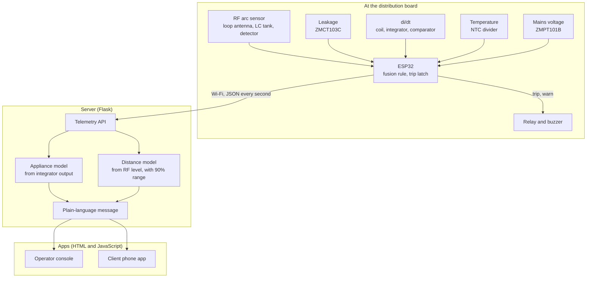
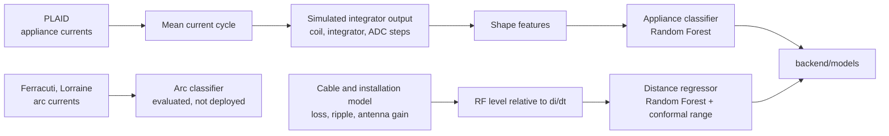

# Fuzz

**Catch the spark before it becomes a fire.**

Fuzz is a low-cost, multi-sensor early-warning device for electrical faults in homes. It installs at the distribution board and watches a branch circuit through independent sensors. It flags a developing fault early, cuts the supply if it escalates, and uses machine learning to estimate which appliance is likely at risk and roughly how far along the wiring the problem is.

> **Project type:** simulation-based capstone. The schematic is complete in KiCad and its analog stages were checked in SPICE, which changed two component values. The machine-learning models are trained on public datasets passed through simulated sensor and cable models. No hardware has been built or measured. See [Limitations](#limitations).

---

## Why this project

Most electrical fires start small: a loose terminal that arcs, insulation that slowly leaks, a joint that heats up. Standard MCBs and RCDs look at one signal and act only once the fault is already serious. Fuzz targets the gap between "normal" and "tripped", and tells the homeowner what is causing the threat.

## What it senses

Four warning channels and one supply-monitoring channel feed a single ESP32:

- **RF arc:** radio noise from sparking at loose joints. Loop antenna, LC tank, envelope detector.
- **Leakage current:** insulation breakdown. Current transformer (ZMCT103C), amplifier, rectifier.
- **di/dt:** very fast current rise, the signature of a short circuit. Coil, integrator, comparator.
- **Temperature:** hot, loose connections. NTC thermistor divider.
- **Mains voltage (supply monitoring):** over- and under-voltage and frequency. ZMPT101B voltage sensing module.

## Detection logic

Two tiers, evaluated on the ESP32 (implemented in the simulator and in the ESP32 firmware; the firmware logic is checked against the simulator but has not run on a board yet):

- **WARNING (predictive):** two or more channels are raised at the same time, meaning each averages above about a third of its limit over the last five readings. A single channel above 80% of its limit, or mains voltage outside plus or minus 10%, also warns. A warning is held for 10 seconds so it does not flicker. The user is notified and nothing is cut.
- **TRIP (protective):** a hard limit is crossed, or the di/dt comparator fires. The relay module opens the supply immediately, without depending on Wi-Fi or the server.

Thresholds are derived in the calculations report in `docs/`.

## Machine learning

The AI is what turns "something is wrong" into "something is wrong, probably here". Outputs:

- **Fault state:** normal, warning or trip (rule-based fusion on the ESP32).
- **Appliances at risk:** several appliances can run on one branch, so this is a multi-label problem. The app reports the appliance family and the most likely devices with probabilities.
- **Probable distance:** estimated distance in metres from the board along the wiring, reported with a confidence range.

How the training data is built:

1. Real appliance and arc current signatures come from public datasets (see [Datasets](#datasets)).
2. Multi-appliance cases are made by adding single-appliance currents together (Kirchhoff's current law), as in the NILM literature.
3. Appliance features are computed from a simulation of what Fuzz's own di/dt integrator output would give the ESP32. Distance features come from a simulated cable and installation model with random junction losses, antenna coupling and arc strength.
4. Models are tested split by house, split by block of recordings, and across datasets.

The Ferracuti arc windows contain the absolute value of the current, not a signed waveform, so the arc classifier uses them as they are and they do not pass through the sensor simulation.

Random Forest and XGBoost were evaluated, and a Random Forest is the model deployed in the backend. The data set is small (about 1,300 appliance records from 16 houses), which favours classical models on hand-made shape features over deep networks. Deep models (1D CNN, ROCKET, CNN-Transformer) were not compared and are listed under [Future work](#future-work).

A channel ablation of the fusion rule is done (see [Results](#results)). SHAP explanations for each alert and alert thresholds that treat false alarms as more costly than missed warnings are future work.

The four-channel fusion itself is rule-based, because no public dataset contains all the sensor signals together.

## System architecture



The trip decision is made on the ESP32 and does not depend on the server or Wi-Fi. The server adds the machine-learning estimates and the plain-language message.

How the models are trained:



## Operator console and client app

Both are built in plain HTML, CSS and JavaScript and are served by the Flask backend.

- **Operator console** (`/`, for a laptop): one live diagram of the circuit, from the distribution board and relay along the wire to the appliance. The relay flips open on a trip, current flows along the wire while it is live, and for an arc fault a marker appears on the wire at the estimated distance with the 90% range shaded on a 0 to 20 m ruler. Below it is one timeline that can be dragged to replay the past. A "Details" button shows the fusion rules, the simulator's true values and the raw packet. The same row of controls runs the demo scenarios.
- **Client phone app** (`/client`, designed for a phone): a soft orb that is calm when all is well, ripples in a warning and goes still after a trip, with a plain-language message such as "arc activity, likely heating appliance, about 10 m away (range 6 to 14 m)", a Sensors page and a History page that replays the past through the orb. On a laptop the same page switches to a side-by-side layout. To see the phone layout on a laptop, open browser developer tools (F12) and turn on device mode (Ctrl+Shift+M).

Until hardware exists, a demo runner inside the backend plays the ESP32's role and sends scenarios (normal use, an arc at a given distance, rising leakage, overheating, a voltage surge). The same simulator is also available as a command-line script.

## ESP32 firmware

`firmware/` is an Arduino-framework PlatformIO project for the ESP32. The comparator interrupt opens the relay without waiting for any other code. The trip latch is stored in flash and cleared by sending `r` over the serial port. A network task on the second core sends the JSON readings to the backend. The fusion rule is the same as in the simulator, and `firmware/host_test/compare.py` checks that the two give identical results on the same inputs. Pin numbers and calibration constants are in `firmware/include/config.h`; the calibration constants are placeholders until the sensors are measured.

## Repository structure

```
hardware/
  kicad/          Full-system schematic (KiCad), exported PDF, BOM
  simulation/     SPICE simulations of the analog stages
firmware/         ESP32 firmware (PlatformIO): fusion, trip latch, telemetry, host tests
ml/
  data/           Datasets (downloaded locally, not committed)
  *.py            Exploration, feature extraction, baselines, simulations, train_models.py
backend/          Flask server: telemetry in, model inference, demo runner, serves the apps
  models/         Saved models (created by ml/train_models.py)
dashboard/        Operator console (console.*) and client phone app (app.*)
demo/             ESP32 simulator, demo video scripts
docs/             Calculations report, schematic PDF
requirements.txt  Python packages
```

## Status

- [x] Sensing strategy and system design
- [x] Full-system schematic in KiCad (ERC run, 0 violations, with some checks ignored)
- [x] Exported schematic PDF and BOM
- [x] Analog stages simulated in SPICE and component values confirmed
- [x] Arc datasets (Ferracuti, Lorraine) downloaded and explored
- [x] Cable and arc-source model for the distance data
- [x] Appliance dataset PLAID downloaded and explored 
- [x] Arc classifier baseline with same-dataset and cross-dataset evaluation
- [x] Training-data generation for appliance mixtures, integrator-output features and distance
- [x] Appliance and distance models evaluated (Random Forest and XGBoost)
- [x] Channel ablation of the fusion rule
- [x] ESP32 simulator and backend telemetry endpoint
- [x] ESP32 firmware (fusion, trip latch, telemetry), logic tested against the simulator on a PC
- [x] Model inference in the backend
- [x] Operator console and client phone app
- [ ] Calculations report
- [x] Demo scenarios runnable from the console
- [ ] Demo video
- [ ] Firmware run on a real ESP32 and sensors

## Datasets

Datasets are not stored in this repo. They are downloaded locally into `ml/data/`. Ferracuti and Lorraine are CC BY 4.0, so credit the authors. For PLAID, the paper is CC BY 4.0 but the licence of the measurement files is not stated separately. The licence of the TI set is still to be confirmed.

- **Arc faults (main):** Ferracuti et al., 2025. Series arc current signatures from 13 load types, 230 V / 50 Hz, IEC 62606. Windows of absolute current, 5 to 50 ms at 10 to 100 kHz, with 2, 5 or 14 class labels. [doi.org/10.5281/zenodo.15279701](https://doi.org/10.5281/zenodo.15279701)
- **Arc faults (cross-dataset test):** Series AC arc fault data from a 230 V / 50 Hz domestic network, University of Lorraine and Huaqiao University. Line current and arc voltage at 1 MS/s for 13 appliance and arc-type recordings. Arc labels come from the arc voltage. [zenodo.org/record/3997337](https://zenodo.org/record/3997337)
- **Appliance identification (main):** PLAID 2018, 17 appliance types, 1,876 single-appliance and 575 multi-appliance recordings at 30 kHz, recorded on 120 V, 60 Hz mains. Scientific Data, 2020, doi 10.1038/s41597-020-0389-7, data at doi 10.6084/m9.figshare.10084619.
- **Optional:** Texas Instruments `ac_arc_fault_log300`, for testing false alarms from masking loads such as dimmers and drills.

No public dataset contains distance, so distance labels come from the simulated cable model.

## Results

- **Arc classifier, same-dataset (Ferracuti, 20 ms windows at 10 kHz, XGBoost):** 98.4% accuracy, 99.4% of arc windows detected, 2.1% false alarms.
- **Arc classifier, cross-dataset (trained on Ferracuti, tested on Lorraine, 457 arc and 1104 normal windows):** 68.9% of arc windows detected with 4.4% false alarms when downsampling with an anti-alias filter, or 78.8% detected with 9.4% false alarms with plain subsampling. Carbonized-path arcs on resistive and drill loads are detected at about 98%. Vacuum cleaner and open-contact arcs are much weaker, and the vacuum cleaner causes most false alarms.
- **Appliance identification, single appliance (PLAID, 11 types, split by house, full current waveform with shape, phase, variability and start-up features):** 76.6% exact accuracy and 94.1% accuracy at family level (heating, motor-driven, electronics, microwave). Heater is often mistaken for hairdryer, and fan for air conditioner, because their current shapes are similar. A random split gives 98 to 99%, which is inflated because recordings from the same house land on both sides.
- **Appliance identification from Fuzz's own sensor (simulated):** the output of the di/dt integrator, read by the ESP32 ADC, supports appliance identification as well as the full current waveform when both use the same shape features (split by house): 69.5% exact and 88.7% family accuracy from the integrator output against 67.4% and 87.3% from the full current waveform. Adding amplitude gives 77.5% and 91.4%, which depends on the assumed coil sensitivity and on PLAID being 120 V.
- **Appliance identification, several at once (PLAID aggregated, split in blocks of records):** macro F1 0.85 over 13 types. With one appliance running the exact set is right in 98% of windows, with two running 53% (84% of the true appliances are in the top two guesses), and with three running 15% (76% in the top three).
- **Appliance identification, cross-dataset:** trained only on synthetic mixtures of single-appliance recordings from 2013 to 2014 houses and tested on real 2017 lab mixtures, macro F1 is about 0.40. Lamp, laptop and fridge transfer (F1 0.87, 0.81, 0.62), but air conditioner and fan do not (F1 0.00).
- **Distance estimate (simulation):** with a single RF band and no calibration the model is barely better than guessing the middle of the circuit (average error 4.1 to 4.9 m against 4.75 m for guessing), with a 90% range 15 to 17 m wide. A second RF band lowers this to 3.5 m in homes that attenuate strongly (1 dB/m of junction and load loss). After a per-home calibration (about 60 labelled events) the error falls to 1.8 m with one band and 0.8 m with two bands at 1 dB/m, and to 3.7 m and 2.3 m at 0.3 dB/m. In homes that attenuate very little (0.1 dB/m) nothing works well.

- **Channel ablation (simulation, fusion rule, 100 runs per case, fault 12 m from the board):** with normal use there were no false alarms with all five channels or with any one removed. Leakage, overheating and a voltage surge are each detected only by their own channel: without it, the fault is never caught. For arc faults all five channels catch 100% of runs, and 79% trip the relay within 60 s with a median warning of 8 s first. Without the RF channel 96% are still caught but the warning time falls to 0 s, so the RF channel is what gives the early warning. Without the di/dt channel 99% are caught but none trip, because at 12 m the RF level alone never reaches its own trip limit. These results show how the rule uses each channel on the simulated scenarios, each of which is built around one main channel. They are not evidence about real sensors.

Windows are labelled as arc when the arc-voltage RMS exceeds 5 V and the appliance is conducting (current RMS above 0.3 A). The 457 arc windows include 47 low-voltage Res7.9A windows (arc voltage up to 5.9 V RMS) whose labels are doubtful and none of which were detected.

## Simulation results

The four analog stages were simulated in LTspice (netlists in `hardware/simulation/`). The simulations changed two component values: U1 is now a roughly 10 MHz rail-to-rail op-amp (TLV9062) instead of a TS912, and R9 is 100k instead of 1M.

- **RF arc channel:** the LC tank resonates at about 970 kHz. Gain at resonance depends on the antenna's source impedance (about +36 dB at 10 ohms, about +23 dB at 50 ohms, untuned at 200 ohms). With a 10 ohm source the detector responds to signals of about 1 to 2 mV and saturates above about 15 mV.
- **Leakage channel:** with R9 at 100k the amplifier has a gain of about 101 and tolerates a few millivolts of offset. A 30 mA leakage gives a swing of about 70 to 80 mV.
- **di/dt channel:** with an assumed 1 microhenry coil, the comparator trips at about 16.5 kA/s and ignores normal 50 Hz load current. The ESP32 must catch the pulse with a falling-edge interrupt.
- **Temperature channel:** the divider output is 0.76 V at 0 C, 1.65 V at 25 C, 2.64 V at 60 C and 3.08 V at 100 C.

## Limitations

- **Simulation only.** Nothing has been built or measured. Circuit values are confirmed by simulation, not on hardware.
- **Distance is simulated.** Distance labels come from a cable model, so accuracy is only as good as that model. Real wiring has junctions, branches and other loads. Distance is reported as a probable range, and field validation is future work.
- **Distance is coarse without calibration.** Cable loss alone carries almost no distance information at 1 MHz, so the estimate relies on junction and load losses that vary from home to home. All cable, source and installation parameters are assumptions, not measurements. A second RF band is proposed as a hardware extension but is not in the current schematic.
- **Appliance guesses are probabilities.** With several appliances running, one can mask another. Results are reported with confidence and a confusion matrix.
- **Appliance identity is device-specific.** Models recognise appliance families well but do not reliably recognise unseen individual devices. A deployed unit would need to learn each household's appliances. PLAID is also recorded on 120 V, 60 Hz mains, not 230 V, 50 Hz.
- **Appliance identification needs one extra connection.** It reads the di/dt integrator output on the ESP32 ADC, which needs the output of U3A wired to a spare pin (IO39). This is a proposed extension and is not in the current schematic.
- **Dataset domain gap.** Public datasets were recorded at the appliance, not through a long cable, and with different equipment from Fuzz's sensors.
- **Rule-based fusion.** Fusion thresholds come from calculation and simulation, not from field data.
- **Single-channel current classifiers did not transfer well across datasets.** This motivates, but does not yet prove, the multi-sensor approach.
- **Simulation assumptions.** The antenna source impedance, the di/dt coil inductance and the NTC beta (3950) are assumed, not measured. The RF channel has no high-pass, so mains pickup is amplified. The leakage rectifier does not hold a DC level, so the firmware samples the waveform instead. The di/dt trip has only about four times margin over normal load, so dimmers and motor starts may need extra handling.
- **Firmware not run on hardware.** The fusion and feature logic is tested on a PC against the simulator, but the full firmware has not been built for the board or run on a real ESP32 with real sensors. ADC calibration, the comparator interrupt timing and the Wi-Fi path are untested.
- **Not a certified device.** This is an educational prototype and must not be used as a safety product.
- **One appliance at a time.** The deployed appliance model assumes a single running load. The multi-label model for several appliances uses full-current windows and is not connected to the backend.

## Future work

- Compare deep models (1D CNN, ROCKET, CNN-Transformer) with the Random Forest on the appliance task, using the same house-split evaluation.
- Validate the appliance model on a second independent data set. COOLL could not be obtained (its password was not received), so it was dropped. WHITED (230 V, 50 Hz) is a candidate.
- SHAP explanations for each alert, and alert thresholds that weigh false alarms against missed warnings.
- A multi-task model for fault state, appliances and distance together. No public data set contains all three, so this needs data from the device itself.
- Build the board, measure the sensors, calibrate the firmware constants and compare the real readings with the simulation.

## Getting started

```
python -m venv .venv
.venv\Scripts\Activate.ps1   # or: source .venv/bin/activate
pip install -r requirements.txt
```

## Running the demo

Train and save the models first (this creates `backend/models/`):

```
python ml\train_models.py
```

Start the backend, then open the two pages in a browser:

```
python backend\app.py
```

- `http://127.0.0.1:5000/` is the operator console. Choose a scenario in the top row and press Run. Scenarios are normal use, arc fault, leakage, overheating and voltage surge. For an arc fault you can also choose the appliance on the circuit and the distance of the fault.
- `http://127.0.0.1:5000/client` is the phone app. Open it next to the console to watch both react to the same run.

The command-line simulator still works for testing, and its readings are available at `http://127.0.0.1:5000/api/units`:

```
python demo\simulator.py arc --distance 10 --appliance hairdryer
```
